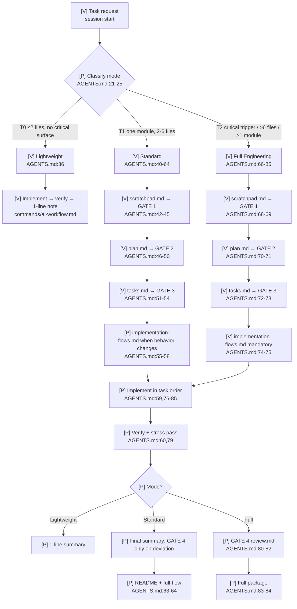
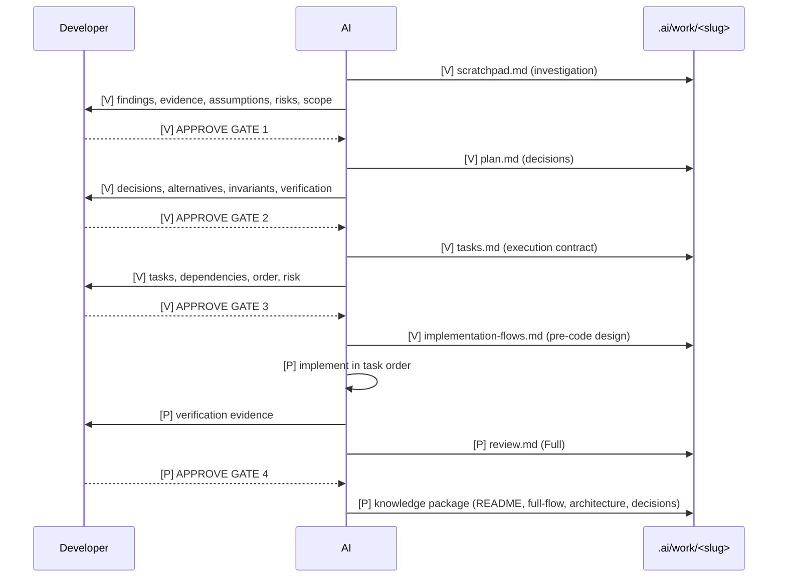

# Engineering Ownership Workflow — full flow

Mode: Full Engineering · Date: 2026-11-07 · Revised: 2026-11-07

## Legend

| Label | Meaning |
|-------|---------|
| `[V]` | Verified installed behavior, with `file:line` |
| `[P]` | Planned or assumed behavior; not runtime-proven |
| `[?]` | Unknown |

## A. Feature overview

- **Business purpose:** keep the developer in control of engineering decisions while AI handles
  implementation and produces durable system understanding.
- **Actors:** developer (owner), AI (implementer), reviewer agent (Gate 4 evidence).
- **Trigger conditions:** any task above Lightweight, and optionally Lightweight for a quick
  summary.
- **Expected outcomes:** approved scope/decisions/execution, pre-code visual flows, verified
  implementation, visual knowledge package.

## B. Full execution flow

## C. Sequence diagram — human gates

## D. Critical decision points

| Decision | Condition | Behavior | File:line | Invariant |
|----------|-----------|----------|-----------|-----------|
| Mode selection | T0/T1/T2 trigger | 0/3/4 gates | `AGENTS.md:21-25` | INV2 |
| Gate 1 | findings ready | Freeze scope | `AGENTS.md:45,69` | INV2 |
| Gate 2 | plan ready | Freeze decisions | `AGENTS.md:49,71` | INV2 |
| Gate 3 | tasks ready | Freeze execution; authorize flows | `AGENTS.md:54,73` | INV3 |
| Flow insertion | after Gate 3 | No code before flows | `AGENTS.md:55-58,74-75`, `commands/ai-workflow.md` | INV3 |
| Gate 4 | Full implementation | Freeze completion | `AGENTS.md:80-82` | INV4 |
| Knowledge depth | mode | README+full-flow or full package | `AGENTS.md:63-64,83-84` | INV4 |
| Context recovery | interrupted session | Verify tasks against code/tests | `AGENTS.md:168-183` | INV6 |

## E. Source code mapping

| Step | File:line | Responsibility | Task |
|------|-----------|----------------|------|
| Policy | `AGENTS.md:8-348` | Modes, gates, artifacts, flows, recovery | T1 |
| Master lifecycle | `commands/ai-workflow.md` | Execute the workflow | T5 |
| Feature path | `commands/create-feature.md` | Standard/Full feature | T5 |
| Bug path | `commands/fix-bug.md` | Mode-aware diagnosis/fix | T5 |
| Pre-code flows | `skills/design-implementation-flows/SKILL.md` | Mermaid design contract | T2 |
| Knowledge package | `skills/transfer-implementation-knowledge/SKILL.md` | README/full-flow/architecture/decisions | T3 |
| Risk ranking | `skills/map-critical-paths/SKILL.md` | Tier A/B/C and flow priority | T4 |
| Failure pass | `skills/stress-test-implementation/SKILL.md` | Surfaces + flow reconciliation | T4 |
| Ownership check | `skills/verify-ownership/SKILL.md` | Level 1-3 questions | T4 |
| Templates | `prompts/templates/*`, `templates/knowledge/*` | Artifact shapes | T7 |
| Validation | `scripts/verify.py` | Contract, refs, parity | T8 |

## F. Production debugging guide

| Symptom | Start at | Then |
|---------|----------|------|
| Workflow still uses the old one-gate model | `~/.config/opencode/AGENTS.md` | compare with repo; run `install.sh`; restart OpenCode |
| New skill not available | `opencode debug skill` | check `skills/design-implementation-flows/SKILL.md`; install; restart |
| Verify reports stale parity | `python scripts/verify.py` | run `bash scripts/install.sh`; re-run |
| Commands write to old plan path | `python scripts/verify.py` workflow check | fix the command; re-run |
| Diagrams missing or text-only | `templates/knowledge/full-flow.md` | check Mermaid fence and `[V]/[P]/[?]` labels |
| Gate text disagrees between files | `AGENTS.md` §2 | update command/template; run verify |

## G. Engineering ownership checklist

### Verified facts

- Mode table and four gates exist in `AGENTS.md:8-109` — verified by `verify.py`.
- Work artifacts and knowledge package exist in templates — verified by `verify.py`.
- New skill loads from `~/.config/opencode/skills/design-implementation-flows` — verified by
  `opencode debug skill`.
- Install parity is clean — verified by `python scripts/verify.py`.
- Runtime mode classification selected Lightweight, Standard, and Full correctly — verified by
  three `opencode run --agent plan` probes; no files were modified.

### Assumptions

- The model will follow the gate text in live sessions. Gates are prompt-driven.
- Mermaid renders in the developer's Markdown viewer.

### Untested behavior

- A real Full-mode session has not been run end-to-end after installation.
- Gate discipline under time pressure is not measured.

### Remaining risks

| Risk | Impact | Mitigation |
|------|--------|------------|
| Rubber-stamp approvals | Gates lose signal | Explicit approval phrases; Lightweight stays 0 gates |
| Stale diagrams | False knowledge | Gate 4 reconciliation; update `[P]`→`[V]` only with evidence |
| Live config drift | Old workflow persists | `install.sh` + parity check |
| Prompt non-compliance | Mode/gate skipped | Simulations and review; `verify.py` checks text contract |

### Understand more deeply

- **The mode table is the contract:** one classification decides gates, artifacts, and knowledge
  depth. Question: "Why does a one-line authz change get four gates while a five-file rename gets
  zero?" Read `AGENTS.md:21-25`.
- **Gate 3 authorizes flows, not code:** the flow file is the last design checkpoint. Question:
  "What must you do if the flow contradicts the plan?" Read `AGENTS.md:55-58,74-75`.
- **Work vs knowledge separation:** `.ai/work/` is process state; `.ai/knowledge/` is durable
  understanding. Question: "Where does a task list belong, and why?" Read `AGENTS.md:275-306`.
