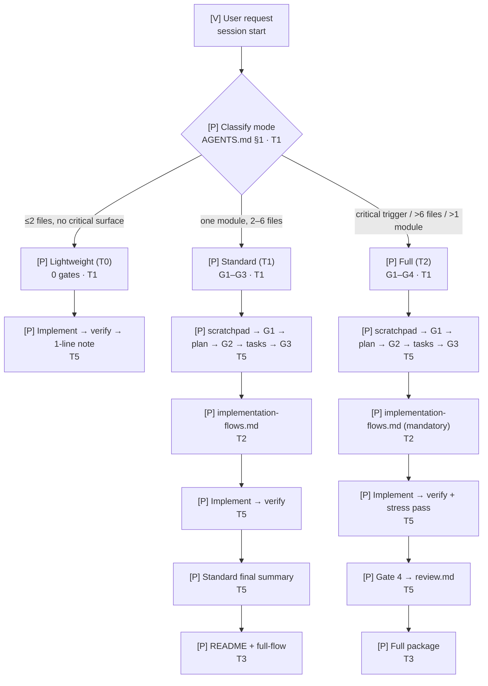
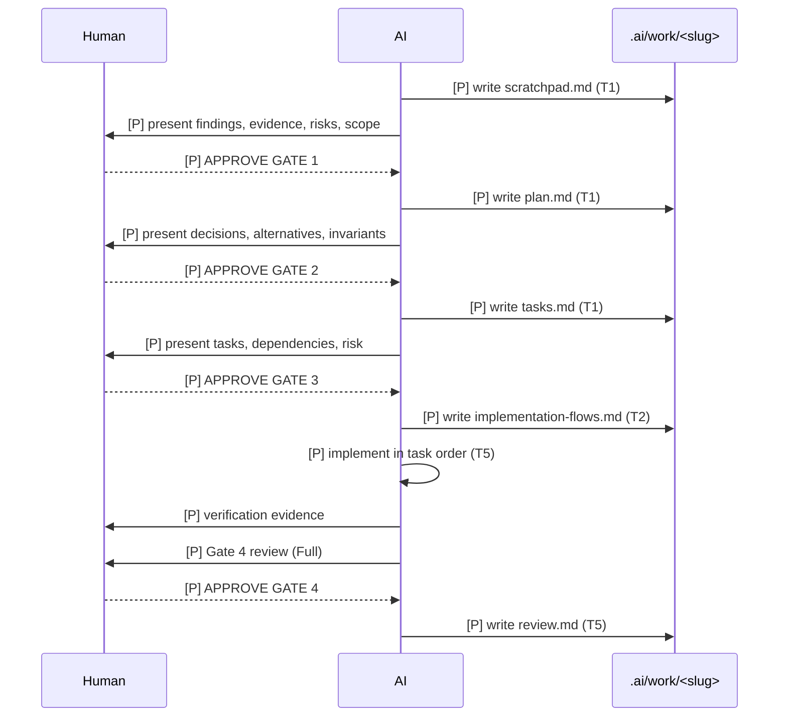
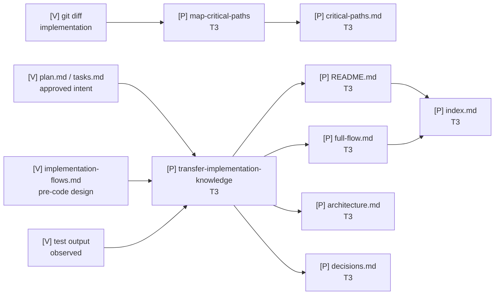
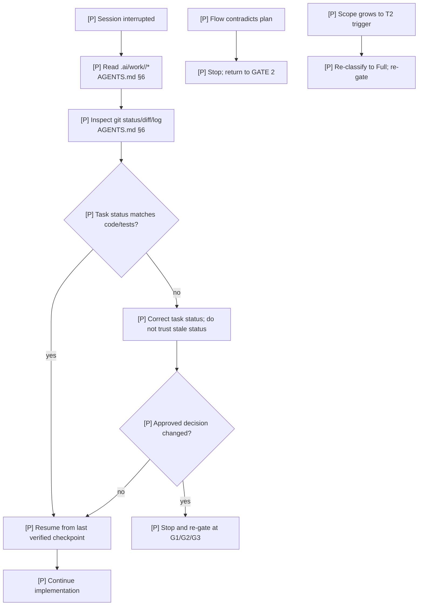

# Engineering Ownership Workflow — implementation flows

Mode: Full Engineering · Plan: `.ai/work/engineering-ownership-workflow/plan.md`
Date: 2026-11-07

## Legend

| Label | Meaning |
|-------|---------|
| `[V]` | Verified existing behavior, with `file:line` |
| `[P]` | Planned behavior, with task ID |
| `[?]` | Unknown |

## Diagram inventory

| Diagram | Why it exists | Risk tier | Tasks covered |
|---------|---------------|-----------|---------------|
| Mode routing | Shows how classification selects gates and artifacts | A | T1, T5 |
| Gate lifecycle | Shows the human approval sequence and flow insertion point | A | T1, T5 |
| Knowledge package | Shows what evidence flows into durable knowledge | B | T3, T7, T12 |
| Failure/recovery | Shows context recovery and re-gating paths | A | T5, T11 |

## Feature execution flow — mode routing

## Gate lifecycle — Standard and Full

## Knowledge package flow

## Failure and recovery paths

## Business logic and critical decisions

| Decision | Condition | Behavior | Plan ref | Task |
|----------|-----------|----------|----------|------|
| Mode selection | classification triggers | T0/T1/T2 map to Lightweight/Standard/Full | D1 | T1 |
| Gate count | mode | 0/3/4 gates | D1 | T1 |
| Flow insertion | after Gate 3, before code | mandatory Full; mandatory Standard when behavior changes | D1/D4 | T2 |
| Knowledge depth | mode | README+full-flow or full package | D3 | T3 |
| Legacy path | old command | canonical `.ai/work/`; legacy note only | D5 | T6 |

## Error propagation

| Trigger | Symptom | Handled by | State left behind |
|---------|---------|------------|-------------------|
| Install not run | live OpenCode still uses old workflow | operator runs `install.sh` and restarts | staging updated, live unchanged |
| Gate text drift | command and policy disagree | `verify.py` workflow check fails | repository inconsistent until fixed |
| Stale plan path | artifact written in two homes | stale-path check fails | commands inconsistent |
| Flow skipped | code exists without design | Gate 3/4 rule + review finding | change not complete |
| Diagram stale | knowledge contradicts code | Gate 4 reconciliation; update `[P]`→`[V]` only with evidence | review should block completion |

## External services and database interactions

Not applicable. This change modifies Markdown configuration, templates, and a Python validation
script. No database, network, or external service is touched.

## Task → behavior mapping

| Task | Behavior | Flow node(s) | Files | Acceptance |
|------|----------|--------------|-------|------------|
| T1 | Mode routing and gates | Mode routing, Gate lifecycle | `AGENTS.md` | tokens present; verify passes |
| T2 | Pre-code flow design | Mode routing → flows | `skills/design-implementation-flows` | skill valid and loadable |
| T3 | Visual knowledge package | Knowledge package | `skills/transfer-implementation-knowledge`, templates | package contract present |
| T4 | Risk/flow/ownership integration | Mode routing, Knowledge package | 3 skills | flow priority and reconciliation present |
| T5 | Command lifecycle | Gate lifecycle | 8 commands | gates and artifacts referenced |
| T6 | Path consistency | Gate lifecycle | 9 commands | stale-path check passes |
| T7 | Templates | Gate lifecycle, Knowledge package | prompt/knowledge templates | Mermaid + labels present |
| T8 | Validation | Failure/recovery | `scripts/verify.py` | `verify.py` 0 fail |
| T9 | Documentation | All | README/docs/context | consistent with workflow |
| T10 | Install | Failure/recovery | live config | dry-run + install succeed |
| T11 | Simulations | All | `docs/VALIDATION.md` | three scenarios documented |
| T12 | Knowledge/Gate 4 | Knowledge package | package + review | Gate 4 evidence present |

## Invariant coverage

| Invariant | Visible in flow? | Node | How enforced |
|-----------|------------------|------|--------------|
| INV1 | yes | Mode routing | `verify.py` contract check |
| INV2 | yes | Mode routing, Gate lifecycle | `verify.py` workflow check |
| INV3 | yes | Gate lifecycle | Gate 3 rule; review |
| INV4 | yes | Knowledge package | transfer skill + templates |
| INV5 | yes | Mode routing, Knowledge package | `.ai/work/` vs `.ai/knowledge/` |
| INV6 | yes | Failure/recovery | install + parity check |
| INV7 | yes | Failure/recovery | `verify.py` config check |
| INV8 | yes | All | `verify.py` run |

## Open questions

- Runtime gate adherence is prompt-driven. Resolved as a non-goal: gates are not mechanically
  enforced; `verify.py` enforces the text contract and simulations test intended behavior.

## Post-implementation reconciliation (2026-11-07)

| Planned element | Actual | Evidence | Status |
|-----------------|--------|----------|--------|
| `AGENTS.md` modes/gates | Installed and schema-valid | `python scripts/verify.py` | verified |
| New flow skill | Loaded by OpenCode | `opencode debug skill` | verified |
| Work artifact contract | Templates + commands reference `.ai/work/<slug>/` | `verify.py` stale-path check | verified |
| Knowledge package contract | Templates + transfer skill updated | `verify.py` contract check | verified |
| Live config sync | 36 + 9 files installed; backups created | `install.sh` output | verified |
| Runtime gate adherence | Not exercised end-to-end | — | untested |
| Mermaid rendering | Not rendered in a viewer this session | — | assumed |
| Standard/Full simulations | Spec-level walkthroughs only | `docs/VALIDATION.md` §8.3 | assumed |

`[P]` nodes in the diagrams above describe workflow behavior that is installed but not
runtime-proven. They should become `[V]` only after a real Standard/Full session exercises the
gates.
