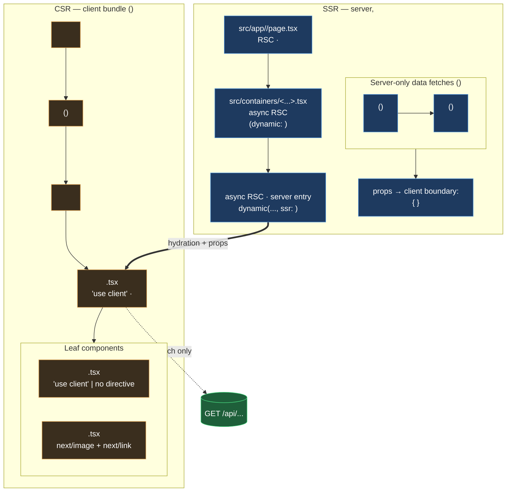

Generate an FE architecture document (SSR/CSR split) for the feature described below. The output must follow exactly this standard structure and flow (the former reference file `CP-508-kurashi-proposal-fe-architecture.md` has been absorbed into this template).

Feature / ticket / description: $ARGUMENTS

## Flow

1. **Locate the feature's FE code** in `cainz-pet-portal` (Next.js App Router, `src/app` — no Pages Router):
   - Route/page files under `src/app/**` — note any `export const dynamic` / `revalidate` / `generateStaticParams` (SSG vs SSR).
   - Container/server components (async RSC, no `"use client"`) and `next/dynamic` imports (check `ssr` flag; default is `ssr: true`).
   - Client components (`"use client"` at line 1), state stores (e.g. Zustand), client-side fetches (`fetch`/api wrappers).
   - Pure/isomorphic utils and constants (no directive — run in both phases); test files (e.g. Playwright).
   - Server-only modules (`import 'server-only'`).
   Use glob/grep (case-insensitive, multiple naming variants); prefer the `explore` subagent for the search phase.
2. **Determine the render mode**: SSR per-request vs SSG/ISR — check for Suspense boundaries around `useSearchParams`, route segment config, `cookies()`/`headers()` usage, `revalidate` exports. State the verdict **and the reason**.
3. **Write the doc** to `C:\sources\cainz\<TICKET>-<feature-name>-fe-architecture.md` using the structure below.
4. **Verify**: every file path in the doc exists (glob-check), mermaid syntax is valid, no secrets/member data appear in the doc.

## Standard document structure

### Title + header block

```markdown
# <TICKET> <Feature Name> — FE Architecture (SSR/CSR diagram)

> Companion to `<companion docs if any>`.
> Shows the SSR/CSR split of the page/components as implemented in `cainz-pet-portal`
> (branch `<branch>`).
> Framework: Next.js <version> / React <version>, App Router only (`src/app`), no Pages Router.
```

Then `---` before each section.

### §1 Component tree — SSR/CSR boundary

One `flowchart TB` mermaid. Skeleton (replace placeholders with real findings):



Rules: thick `==>` edge only for the server→client hydration/props boundary; dotted `-.->` for client-only external calls; `class server/client/boundary` applied to all nodes; node labels carry real file paths + rendering markers (`RSC`, `async RSC`, `'use client'`, `import 'server-only'`, revalidate values).

### §2 Render lifecycle — what runs where

One `sequenceDiagram` mermaid split into exactly two `rect` blocks. Skeleton:

```mermaid
sequenceDiagram
  autonumber
  participant B as Browser
  participant N as Next.js server (SSR)
  participant X1 as <external server dependency 1>
  participant X2 as <external server dependency 2>

  rect rgb(30,58,95)
    Note over N,X2: SSR pass — identical for all users
    N->>X1: <server fetch 1>
    X1-->>N: <data> (failure → <fallback>)
    N->>N: <server-side pure logic>
    N->>X2: <server fetch 2 (if any)>
    X2-->>N: <data>
    N-->>B: HTML shell: <what is in the SSR HTML vs pending client state>
  end

  rect rgb(58,46,30)
    Note over B: Hydration + CSR pass — <member/user-dependent>
    B->>B: hydrate <ClientComponent>
    alt <unauthenticated / precondition A>
      B-->>B: <UI state A>
    else <authenticated>
      B->>B: <client fetch / endpoint>
      alt <error branch>
        B-->>B: <quiet/error UI>
      else <success branch>
        B->>B: <pure logic: resolve → filter → pick>
        B-->>B: <final UI composition>
      end
    end
  end
```



### §3 File map (server vs client)

Markdown table, columns `File | Rendering | Role`:

- **Rendering vocabulary** (use exactly these): `RSC` | `async RSC` | `async RSC (server entry)` | `**\`"use client"\`**` | `client bundle` | `client` | `server-only` (or `server-only (\`import 'server-only'\`)`) | `isomorphic`
- **Role**: one line — what the file does, key exports, cache/revalidate values, test coverage, TODO/stub markers.
- Rows in flow order: route → container → server entry → client root → leaf components → utils → server libs → client libs → stores → constants.

### §4 Key facts

Bullets with **bold lead-in colon** style. Must cover:

- **Render mode verdict + evidence** (which config/export/Suspense fact proves SSR vs SSG/ISR).
- **`next/dynamic` behavior** (ssr flag → does the RSC still run on the server).
- **What crosses the server→client boundary** (exact props) vs what is fetched after hydration.
- **Server fetch caching** (per-request vs revalidate value; which fetch is cached, which isn't).
- **Isomorphic/pure logic** and its test coverage.
- Any feature-specific gotcha (stubs, TODOs, temporary codes).

## Rules

- Ground every claim in actual code — never invent paths, prop names, states, or cache values; verify paths with glob.
- Mark TODO/unverified items explicitly instead of guessing.
- Keep section numbering `## 1.`–`## 4.` with `---` separators, matching this template.
- Scope: read-only exploration + one new markdown file. Do not modify any code.