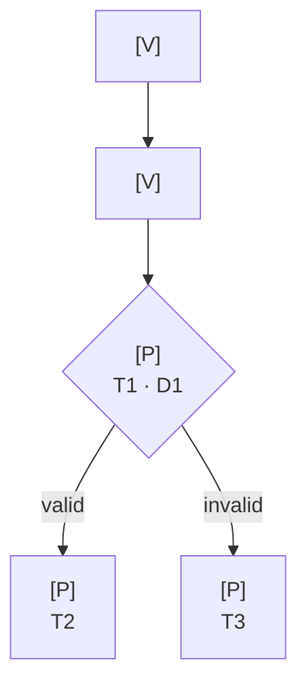
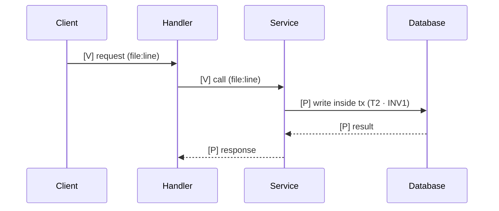
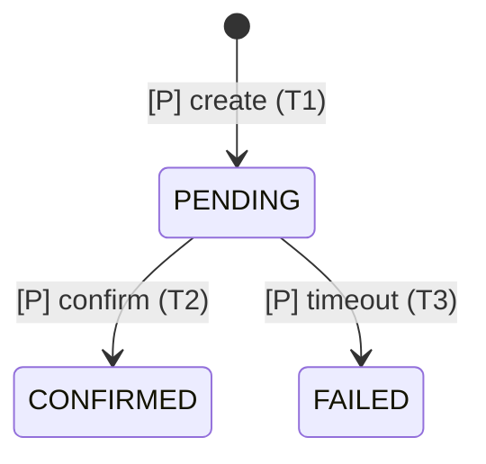

# Template — implementation flows (pre-code design)

> Work artifact. Target: `.ai/work/<slug>/implementation-flows.md`.
> Mandatory for Full Engineering; mandatory for Standard when the change alters runtime behavior
> and meets the trigger in `AGENTS.md`.
> No source changes before this file exists.

# <feature> — implementation flows

Mode: <Standard | Full Engineering> · Plan: `.ai/work/<slug>/plan.md`
Date: <YYYY-MM-DD>

## Legend

| Label | Meaning |
|-------|---------|
| `[V]` | Verified existing behavior, with `file:line` |
| `[P]` | Planned behavior, with task and plan-decision reference |
| `[?]` | Unknown; see open questions |

## Diagram inventory

| Diagram | Why it exists | Risk tier | Tasks covered |
|---------|---------------|-----------|---------------|
| Feature flow | <question it answers> | A/B/C | T1–T4 |

## Feature execution flow

## Component interactions / sequence

## State and data

<State diagram or ER diagram when applicable; otherwise "not applicable" and why.>

## Business logic and critical decisions

| Decision | Condition | Behavior | Plan ref | Task |
|----------|-----------|----------|----------|------|
| <decision> | <condition> | <behavior> | D1 / INV1 | T2 |

## Error propagation

| Trigger | Symptom | Handled by | State left behind |
|---------|---------|------------|-------------------|
| <failure> | <what the caller sees> | <handler> | <committed / rolled back> |

## External services and database interactions

| Dependency | Operation | Timeout / retry | Failure behavior |
|------------|-----------|-----------------|------------------|

## Task → behavior mapping

| Task | Behavior | Flow node(s) | Files | Acceptance |
|------|----------|--------------|-------|------------|
| T1 | | | | |

## Invariant coverage

| Invariant | Visible in flow? | Node | How enforced |
|-----------|------------------|------|--------------|
| INV1 | yes/no | | |

## Open questions

- <unknown> → <how to resolve> → <blocking task or decision>

## Post-implementation reconciliation

<Filled after implementation: change `[P]` to `[V]` only with evidence; record deviations.>
