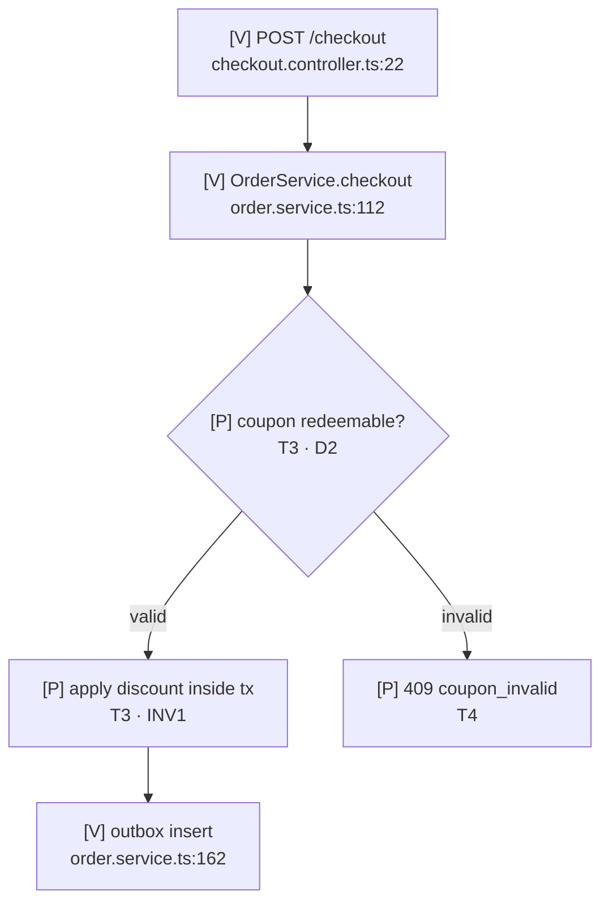

# Skill: design-implementation-flows

Make the intended implementation understandable **before** code exists. This is a design
artifact, not decoration: every diagram must explain behavior the code will actually have, and
every planned element must trace back to an approved task or decision.

## When to use

- Full Engineering: mandatory after Gate 3 and before source changes.
- Standard: mandatory when the change alters runtime behavior; use a compact flow (one flowchart
  plus the primary failure path). Pure refactor/rename with identical behavior is the only
  exception; state why.
- Re-generate when a later change alters execution behavior.
- Skip for Lightweight work and for pure renames/refactors with identical behavior; state why.

Not for: post-implementation knowledge transfer (that is `transfer-implementation-knowledge`),
code review, or implementation itself.

## Inputs

1. `.ai/work/<slug>/scratchpad.md` — verified existing behavior and unknowns.
2. `.ai/work/<slug>/plan.md` — approved decisions, invariants, failure modes, security.
3. `.ai/work/<slug>/tasks.md` — task IDs, files, acceptance criteria, risk.
4. The actual code: entry points, call chain, transactions, external calls, state transitions.

Use `trace-execution-flow` to establish existing behavior. Do not infer a call chain from names.

## Procedure

### 1. Establish the evidence map

List the entry points and the real call chain with `file:line`. Record what is verified, what is
assumed, and what is unknown. Unknown behavior never becomes a diagram node without a `[?]`
label and an open question.

### 2. Select only useful diagrams

| Diagram | Use when |
|---------|----------|
| Flowchart | Always for Full; for Standard when behavior changes (compact) |
| Sequence | API request/response, service-to-service calls, async events, external integrations |
| State | Any lifecycle, status field, or state machine |
| ER | Schema changes, new relationships, data ownership questions |
| Architecture | New component boundary, module dependency, or integration point |

Do not generate a diagram that does not answer a question a maintainer will ask.

### 3. Draft with explicit labels

Every node and edge carries one of:

- `[V]` verified existing behavior — cite `file:line`.
- `[P]` planned behavior — cite the task ID (`T3`) and the plan decision (`D2`) it implements.
- `[?]` unknown — cite the open question; do not invent behavior.

Example:



Use multiple focused diagrams. A diagram with more than roughly 15 nodes is usually two
diagrams.

### 4. Cover the non-happy paths

For Full Engineering, every high-risk path includes:

- Validation failure.
- Timeout / downstream failure.
- Partial failure and rollback behavior.
- Retry / duplicate delivery where relevant.
- Authorization denial where relevant.
- State transition after failure.

If a failure path is not implemented, mark it `[?]` and record it as a risk or non-goal.

### 5. Write the artifact

Target: `.ai/work/<slug>/implementation-flows.md`.

Required sections:

```markdown
# <feature> — implementation flows

## Legend
[V] verified existing · [P] planned · [?] unknown

## Diagram inventory
| Diagram | Why it exists | Risk tier |

## Feature execution flow
<flowchart>

## Component interactions / sequence
<sequence diagrams>

## State and data
<state / ER diagrams, or "not applicable" with reason>

## Business logic and critical decisions
| Decision | Condition | Behavior | Plan ref |

## Error propagation
<flow or table: trigger → symptom → handled by>

## External services and database interactions
<sequence or table>

## Task → behavior mapping
| Task | Behavior | Flow node | Files | Acceptance |

## Open questions
- <unknown> → <how to resolve>
```

### 6. Validate before code

- Every `[V]` node has a real `file:line`.
- Every `[P]` node maps to an approved task and plan decision.
- Every task in `tasks.md` appears in the mapping table.
- Every invariant in `plan.md` is visible in a flow or explicitly marked as not flow-visible.
- No diagram contradicts the approved plan.

If validation exposes a new decision, stop and return to Gate 2. If it exposes a new task, stop
and return to Gate 3.

### 7. Keep it synchronized

After implementation, compare the code to the flows. Update labels from `[P]` to `[V]` only when
the behavior is actually verified. Record deviations in `review.md` and, for Full work, in the
knowledge package `full-flow.md`.

## Quality gates

- A reader can understand the intended implementation without reading `tasks.md` first.
- Every high-risk path has a diagram or a stated reason it cannot be represented.
- Failure and alternative paths are present for Full work.
- Mermaid source stays inside Markdown; no external diagram service.
- No invented behavior, no decorative diagrams, no empty sections.

## Non-goals

- Implementing code.
- Reviewing or grading the implementation.
- Writing the durable knowledge package (`transfer-implementation-knowledge` owns that).
- Diagramming boilerplate that has no branches, state, or failure behavior.
