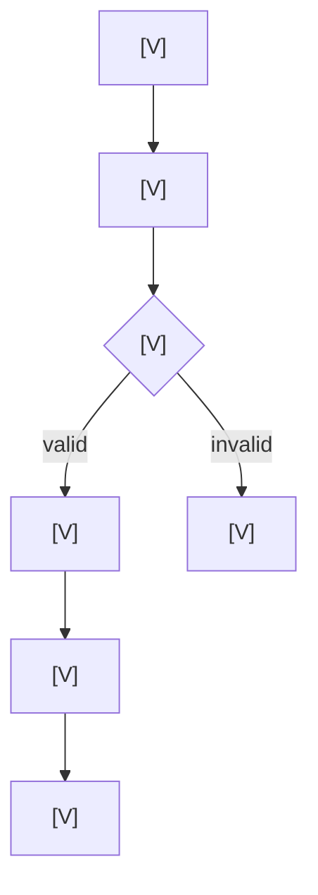
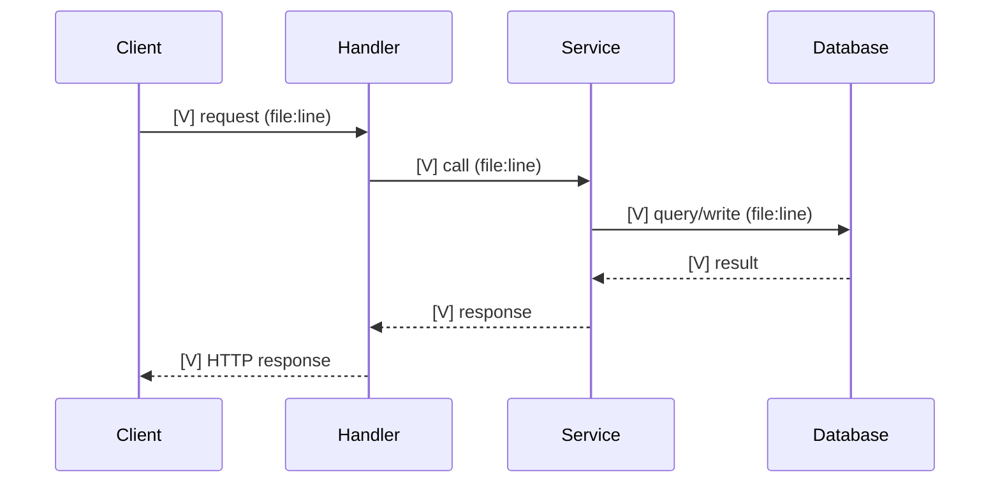

# <feature> — full flow

> Mandatory visual knowledge for every Standard/Full feature that changes runtime behavior.
> Keep under 200 lines. Mermaid source stays in this file.

Mode: <Standard | Full Engineering> · Date: <YYYY-MM-DD> · Revised: <YYYY-MM-DD>

## Legend

| Label | Meaning |
|-------|---------|
| `[V]` | Verified existing behavior, with `file:line` |
| `[P]` | Planned behavior, with task ID |
| `[?]` | Unknown or unverified |

## A. Feature overview

- **Business purpose:** <why this exists>
- **Actors:** <who or what triggers it>
- **Trigger conditions:** <entry conditions>
- **Expected outcomes:** <durable effects and responses>

## B. Full execution flow

Include the complete lifecycle, alternative paths, validation failures, and error paths. If the
feature has more than one independent flow, add a second focused diagram.

## C. Sequence diagrams

Add diagrams for internal services, external integrations, async events, and error handling where
applicable. Skip a diagram only with a stated reason.

## D. Critical decision points

| Decision | Condition | Behavior | File:line | Invariant |
|----------|-----------|----------|-----------|-----------|

Include transaction boundaries, retry behavior, state transitions, authorization checks, and
failure handling. This is the Level 3 ownership section.

## E. Source code mapping

| Step | File:line | Class/function | Responsibility | Task |
|------|-----------|----------------|----------------|------|

## F. Production debugging guide

| Symptom | Start at | Then |
|---------|----------|------|

Include the first breakpoint or log, the failure points that matter, how errors propagate, and the
fastest check for each symptom. No "check the logs".

## G. Engineering ownership checklist

### Verified facts

- <fact> — `file:line`

### Assumptions

- <falsifiable assumption> — why it matters

### Untested behavior

- <what nobody has run> — risk

### Remaining risks

| Risk | Impact | First check / mitigation |
|------|--------|--------------------------|

### Understand more deeply

**1–3 items maximum.**

- **<mechanism>** — why it matters · the question you should answer without looking ·
  read `<file:line–line>`

## Diagram maintenance

- Update this file in the same change that alters execution behavior.
- Change `[P]` to `[V]` only with evidence.
- Never invent behavior to complete a diagram; use `[?]` and add an open question.
